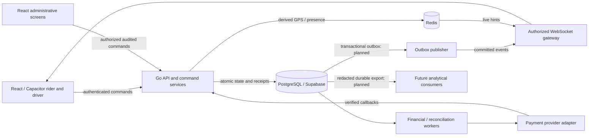

# Cruize Ride full-stack architecture

Prepared 26 October 2026, Africa/Johannesburg. This is a source-evidence assessment and target design, not deployment certification. See [implementation tracker](CRUIZE-RIDE-P0-IMPLEMENTATION-TRACKER.md), [event/API contracts](CRUIZE-RIDE-EVENT-AND-API-CONTRACTS.md), [integration matrix](CRUIZE-RIDE-INTEGRATION-MATRIX.md), and [production gates](CRUIZE-RIDE-PRODUCTION-READINESS-GATES.md).

## Evidence and scope

The starting baseline is branch `fix/ecc-sprint-1-accessibility-wallet`, HEAD `31c9ae007b8c5e6f4741139a4b2ed98e693e2184`. The working tree already contained ride, business, driver, WebSocket, mobile, GPS and staging-contract changes. Preserve these changes; use the tracker for the verified inventory and this program's precise change list.

Research inputs under `C:\REA-Workspace\Reports` are the phase-2 architecture audit, feature-comparison CSV, implementation plan, bidding architecture recommendations, verified feature-gap analysis and action-consumer evidence. Recommendations are proposals. Local inDrive declarations/UI callbacks provide no proof of its private server, assignment, monetary or deployment architecture. This design is original Cruize Ride work.

Status terms used here:

- **Source present:** inspected source implements some behavior; runtime correctness and deployment remain unverified.
- **Partial:** source exists but the end-to-end invariant or security boundary is incomplete.
- **Planned:** a required boundary or implementation has not been established in inspected active paths.
- **Deployed unknown:** no live environment, secrets, production database, provider account or infrastructure was inspected in this program.

No technology in this assessment earns the classification "already deployed" merely because a file, migration, feature flag, readiness report or test name exists.

## System ownership

Retain React/TypeScript/Capacitor and the modular Go backend. PostgreSQL/Supabase owns durable business state; Redis owns disposable discovery/presence projections and cross-node fanout. Authenticated WebSockets deliver committed hints and, after the outbox milestone, replayable business events. Keep Railway as the current intended deployment target; its active runtime configuration is unverified.

The diagram distinguishes target outbox/export links from present source wiring. It does not assert that these links currently operate.

## Current implementation and critical gaps

| Boundary | Evidence in repository | Assessment and required closure |
|---|---|---|
| Ride and offer commands | `backend/internal/rides/handler.go`; routes in `backend/cmd/server/main.go:312`; `src/lib/offerHelpers.ts`; `src/lib/rideMatching.ts` | Source present, partial authority. Handlers, SQL RPCs and direct writes diverge. P0.1 narrowly repairs rejection/cancellation/identity; it does not complete the command layer. |
| SQL compatibility | `supabase/migrations/20260823120000_lock_down_rides_writes.sql:136` | P0.1 aligns Go and local RPC ride-before-offer lock order; eligibility and agreed-price behavior still differ. Actual applied function/grant/trigger definitions need separate schema evidence. |
| Negotiation | `offers`, ride `counter_offer`/fare handling in `rides/handler.go`; dispatch `ride_offers` in `backend/internal/dispatch/repository.go` | Two different models: negotiated bid versus dispatch invitation. Immutable current-proposal revision and its expiry are planned; do not conflate table names or enable a new UI protocol prematurely. |
| Driver discovery | `backend/internal/geo/service.go:126`, `:163`, `:188`; `backend/internal/dispatch/geo_provider.go`; `backend/internal/drivers/handler.go`; `src/lib/driverPresence.ts` | Redis GEO and presence exist. Candidate freshness, persisted eligibility and final assignment are distinct checks. Existing GPS changes must be retained and validated. |
| Assignment | `backend/internal/rides/handler.go` acceptance paths; `backend/internal/dispatch/service.go`; `dispatch/repository.go:304` | Partial. Temporary Redis locks do not enforce cross-ride single-driver assignment; PostgreSQL reservation/uniqueness and one acceptance transaction are required. |
| Realtime | `backend/internal/websocket/{auth,authorizer,manager}.go`; `src/lib/backendSocketClient.ts` | P0.2 corrects canonical identity/state policy, enforces token lifetime and reconciles reconnect scope. Deployed session revocation, real-service verification and durable replay remain open. Local sequence is not an aggregate version. |
| Wallet and ledger | `backend/internal/wallet/money.go:14`; `repository.go:220`; `settlement.go:32`; `active_settlement.go`; `reconciliation.go:17` | Significant source exists: exact money, ledger posting, shadow settlement, gated active settlement, reconciliation and operations. Do not call this missing or financially certified. Ride completion and successful settlement remain separate outcomes. |
| Local payment methods | `backend/internal/payments/provider.go:48`; `service.go:75`, `:79`, `:83`, `:311`; `src/components/wallet/EcoCashPaymentModal.tsx` | OneMoney, EcoCash, Innbucks, PayPal/card abstractions and signed callback validation exist. Generated deposit intents and adapter code do not prove provider connectivity, certification, funds movement or supported commercial availability. |
| Fraud and identity | `backend/internal/risk/{service,repository,http}.go`; `src/lib/fraudDetection.ts`; `src/components/driver/DriverSelfieCheck.tsx` | Source-present risk events/scoring/admin actions and client signals. Client fraud reports/selfie UI are evidence inputs, not authoritative identity verification or irreversible financial controls. |
| Admin and disputes | `backend/internal/business/handler.go:31`, `:67`; `backend/internal/wallet/admin_http.go`; `backend/internal/risk/http.go:16`; `src/pages/admin/AdminDisputes.tsx` | Source-present support/admin workflows. Verify object authorization, participant identity, role checks, maker/checker rules and append-only audit for every privileged mutation. |
| Geofences | Discovery city/category keys in `geo/service.go:235`; service/town pricing and admin screens | No dedicated enforceable geofence contract was established in inspected active geo/risk/business paths. City strings and displayed polygons cannot prove server containment. Versioned policy and server validation are planned. |
| Operations | `backend/internal/observability/observability.go`; `backend/internal/readiness`; `main.go:298`–`:309`, `:334`; `docs/grafana/wallet-dashboard.json` | Prometheus, OpenTelemetry/Sentry wiring, health/readiness and shutdown source exist. Coverage, alert delivery, resource limits, restoration and Railway deployment are unverified. |
| Packaging | `backend/Dockerfile`; `docker-compose.yml`; `android/app/src/main/java/zw/co/pickme/MainActivity.java`; `capacitor.config.ts` | Docker API/worker/scheduler binaries and Capacitor bridge exist. Build reproducibility and installed-device behavior need validation. |

Line references identify inspected anchors; concurrent P0.1 edits may move handler lines. Function names and file paths are the stable references.

## Authoritative domain and transaction design

The full command contract belongs in the event/API document. Use `CreateRide`, `SubmitDriverOffer`, `CounterOffer`, `AcceptOffer`, `RejectOffer`, `WithdrawDriverOffer`, `CancelRide`, `AssignDriver`, `StartTrip`, and `CompleteTrip`. Separate rider rejection from driver withdrawal. Derive actor from authenticated context. Distinguish `drivers.id`, `drivers.user_id` and `rides.user_id`; `rides.driver_id` references the driver row, while negotiated offers currently use driver auth identity.

Retain existing table/API names where compatibility permits. Introduce proposal revisions, aggregate versions, receipts, outbox and reservations through reviewed additive migrations after schema provenance is established. Do not create a parallel replacement ride store without a conversion and ownership plan.

The target lock hierarchy is command receipt, ride, driver/reservation, offers in stable ID order, then proposal rows. All competing commands, expiry jobs and compatibility SQL must use the same hierarchy. Multi-ride operations acquire sorted ride IDs first. A transaction validates current state, actor, eligibility, exact proposal, version and fresh post-lock database time; writes state, winning assignment, losing-offer outcomes, receipt and outbox; commits once. Network/provider/Redis calls stay outside locks. Uniqueness is the final assignment guard, including the same driver winning different rides.

Use exact decimal or integer minor units plus explicit currency. Existing wallet money types provide a reusable boundary; current ride floating-point paths require a compatibility conversion design. Accept loads stored agreed terms; it never accepts a new client amount. Trip completion schedules settlement; provider response does not rewrite trip history. Cash marks an attested collection/commission obligation, not a verified bank deposit.

P0.1 conditional state changes prevent repeat side effects but are not durable general idempotency. Outbox delivery and command receipts remain future work. Report failures after commit as uncertain delivery requiring reconciliation, not permission to repeat a mutation through a weaker RPC.

## Payments, settlement, disputes and risk contracts

| Contract | Required invariant and verification |
|---|---|
| Cash collection/settlement | Bind settlement to committed ride ID, exact agreement, currency and server commission policy version. Distinguish collection attestation, driver liability, platform receivable and actual repayment. Duplicate completion/worker retry posts one settlement. |
| Ledger posting | Post balanced debit/credit entries per currency inside one transaction; immutable posted entries, unique operation reference, deterministic account lock order, no negative spendable balance except an explicitly permitted account type. Correct through reversal entries, never silent ledger edits. |
| Provider deposits/withdrawals | Bind actor-scoped idempotency key to amount/currency/provider. Verify callback signature, freshness, stable provider event identity, expected intent/reference and independently confirmed status before credit; replay and conflicting callback tests must use provider fixtures and a disposable database. |
| Reconciliation | Compare ledger, intent state and imported provider statements; record discrepancies and reviewed resolutions; retain statement/import identity. A balanced ledger alone does not prove provider cash reconciliation. |
| Disputes/refunds | Authorize trip participants and supported support roles; store reason/evidence and decision audit; refund/reversal is its own idempotent financial operation. A resolved support ticket is not proof a refund occurred. |
| Identity/risk | Keep identity document/selfie access restricted and retained by policy. Server risk actions record actor, reason, evidence and expiry; client scores never grant eligibility. Audit blocked-user overrides. |
| Geofence | `CheckServiceability(coordinates, service, policyVersion, serverTime)` returns a typed decision/reason. Validate finite/range coordinates, polygon edges, holes and policy changes; enforce again before assignment where required. Admin changes require a distinct audited permission. |

Existing financial tests and pilot/governance modules are valuable source evidence. They do not replace real transactional, provider-sandbox, reconciliation, restore or release authorization evidence. `wallet/active_settlement.go:34` starts completion settlement in a configuration-gated background goroutine; this is not durable enqueueing. A process crash after ride commit can lose that invocation unless an independently verified recovery process discovers it. The completion-to-settlement outbox/job handoff is a required closure, even when individual ledger operations are idempotent.

## Mobile integration

The rider path spans `src/pages/RideMatching.tsx`, `src/pages/LiveTrackingPage.tsx`, `src/components/ride/DestinationSearchScreen.tsx`, `src/lib/offerHelpers.ts` and `src/lib/rideMatching.ts`. The driver path spans `src/pages/DriverDashboard.tsx`, `src/pages/driver/DriverRideRequests.tsx`, `src/hooks/useDriverTracking.ts`, and `src/lib/driverPresence.ts`.

Preserve existing screens and APIs. Follow-up rider work must display proposed fare separately from recommendation and accepted fare; compare offer fare/distance/profile; bind counters/acceptance to the current proposal revision; wait for committed cancellation; clear stale offers after snapshot reconciliation. Driver work must display rider fare, own current offer/counter revision and server expiry; eligibility-filter requests; make assignment acknowledgement distinct from submitting a price; recover canonical state after reconnect. UI absence or presence must be established with focused browser/device checks before claiming a flow complete.

Background GPS needs an Android foreground-service/notification and permission lifecycle appropriate to supported OS versions, clear start/stop semantics, sampled/received timestamps, session epoch/sequence, accuracy, adaptive sampling, offline bounds and termination on logout. Native Kotlin is warranted only for a demonstrated plugin/OS gap; keep the Capacitor API typed so a native plugin can replace its implementation. Do not introduce Flutter or rewrite Java/React screens on speculation. Never use stale location or a reconnect alone to assert availability.

## Technology decisions and deferred interfaces

The classification is prospective priority; runtime deployment remains unknown for every row. No installs or infrastructure changes are authorized by these decisions.

| Technology | Classification | Boundary now and adoption gate |
|---|---|---|
| React/TypeScript/Capacitor, Go, PostgreSQL/Supabase, Redis, authenticated WebSockets | Needed in P0; source present | Strengthen existing APIs, authorization and durable invariants. Do not replace modules wholesale. |
| Railway | Needed in P0 as existing intended host | Preserve current target. Verify configuration, secrets, TLS, health, rollback and restore through separately authorized nonproduction validation. |
| Docker | Needed in P0 packaging/validation; source present | Maintain API/worker/scheduler executable boundaries, signal handling, nonroot image, explicit environment and probes. Validate image build, resource budgets and shutdown; do not deploy it here. |
| Python analytics/demand forecasting | Architecture/interface readiness only | Consume versioned redacted exports; output `Forecast(cell, horizon, generatedAt, modelVersion, confidence)`. Forecast cannot mutate fare, assignment or eligibility. Promote only after data-quality and forecasting benefit benchmarks. |
| Kafka-compatible streaming | Architecture/interface readiness only | Transport-neutral committed-event publisher, stable IDs, aggregate partition key, schema version and at-least-once consumers. Adopt only when measured retention/fanout/throughput exceeds the simpler outbox delivery design. |
| gRPC | Architecture/interface readiness only | Typed internal service ports with auth context, deadline, idempotency and domain errors. Add wire protocol when a measured independently operated service boundary needs it; no microservice split is required now. |
| Kubernetes | Not justified for the current system | Keep deployable processes, health/resource/shutdown contracts. Reconsider with measured multi-service capacity/availability needs and operational ownership. No cluster manifests or installation needed. |
| Terraform | Architecture/interface readiness only | Inventory provider resources, ownership, secrets references and rollback/import strategy before codifying infrastructure. Adopt after Railway/provider ownership and drift requirements are agreed. Never import live resources automatically. |
| Kotlin | Architecture/interface readiness only | Capacitor location/permission bridge; device tests for process death, permissions, battery and background notification. Adopt only for an evidenced native capability gap. |
| Flutter | Not justified for the current system | Public API/event contracts remain platform-independent. No second mobile codebase or rewrite unless measured requirements show React/Capacitor cannot meet them. |
| Analytical store/data pipelines | Later milestone | Redacted incremental export with durable cursor, schema version, correction/tombstone semantics, retention and access policy. Select a store only after volume, latency and query requirements are measured. PostgreSQL remains transactional authority. |

Deferred boundaries need executable contract fixtures/tests in their implementation milestone: event round-trip and unknown-field compatibility; duplicate/redelivered/out-of-order events; consumer restart/cursor recovery; gRPC-equivalent error/deadline behavior; redaction/deletion propagation; forecast staleness/version checks; native background session ordering; container dependency loss and SIGTERM. These tests are obligations, not claims that new infrastructure or executable suites were added by this documentation.

## Observability, resilience and rollout

Extend existing observability rather than duplicate it. Structured Go logs carry request ID, trace ID, command/event ID, operation, safe aggregate identifier, outcome and latency; exclude tokens, payment secrets, precise location and identity evidence. Propagate trace context across HTTP, outbox and workers. Guard metric cardinality: operation/state/result are labels; user/ride/command IDs are not.

Required measurements include API latency/error rate, matching/acceptance latency, active WebSocket connections, queue depth/drops, Redis dependency failures, database pool wait/transaction duration/deadlocks, assignment conflicts, stale GPS rejection, outbox pending count/oldest age/retries, reconciliation discrepancies and provider callback security failures. Existing generic counters do not establish full coverage. Configure thresholds from baseline/SLO measurements and demonstrate alert routing before production approval.

Liveness checks process health; readiness checks necessary dependencies and schema compatibility without exposing secrets. Test graceful HTTP/WebSocket/worker drain, bounded shutdown, retry ownership and resumption. Validate Redis outage without lost committed state, publisher crash after commit, database failover, duplicate callbacks and backlog recovery. Define finite CPU/memory/connection/queue budgets. Backup policy requires encrypted backup, retention, restore rehearsal and measured RPO/RTO; a configured backup alone is insufficient.

Roll out additive schema changes before dependent code, retain old read compatibility, route mutation authority deliberately, and stop old writers before tightening grants. Rollback cannot restore permissive legacy mutation paths or undo posted money by overwriting records. Use feature flags only where their fail-safe behavior is tested. Refer to the production gates document for evidence and signoff requirements.

## Decisions and next work

P0.1 is bounded to approved rider rejection, terminal cancellation and assigned-driver identity fixes plus regressions. No new schema, production action, broad mobile rewrite or acceptance-policy change belongs in that patch. Implementation/test results are recorded in the tracker, not inferred from this design.

Subsequent program groups use these fixed names: **P0.2 realtime security**, **P0.3 assignment concurrency**, **P0.4 negotiation**, and **P0.5 reliable recovery**. P0.2 closes canonical room/location identity, continuing authorization and revocation. P0.3 establishes acceptance authority, lock order and durable reservations. P0.4 introduces immutable proposals, proposal-aware `WithdrawDriverOffer`, expiry and mobile negotiation contracts. P0.5 establishes receipts/outbox/versioned replay and recoverable workers, including the completion-to-settlement handoff. Financial certification, geofencing, observability and operations remain cross-cutting release gates; they do not rename these groups. P0.3 through P0.5 require one coordinated schema owner even when consumer fixtures and independent security work proceed concurrently.

Before acceptance changes: decide negotiated versus fixed-fare authority, driver withdrawal semantics and offer lifetime; inspect actual staging schema/grants/triggers; unify cancellation states and server fee policy; choose shared SQL authority or retire independently callable RPC mutation paths safely. Before financial rollout: verify exact money conversion, provider certification, ledger constraints and reconciliation evidence. Before precise tracking rollout: close room/location authorization and reconnect revocation gaps.

**Next patch: conditional GO** for a separately reviewed source-only security/contract slice after ownership and compatibility boundaries are fixed. **Acceptance/reservation migrations: NO-GO** until schema and product decisions are resolved. **Production deployment: NO-GO** until real integration, security, operations and environment evidence passes the production gates.

## P0.2 implemented source boundary (26 October 2026)

This section supersedes the earlier source-gap descriptions for room identity, token lifetime and client rejoin handling. Applied production schema and RLS remain unverified.

Room authority is PostgreSQL: rides.user_id is the rider auth subject; rides.driver_id references drivers.id, whose user_id is the driver auth subject. Owners may join pending (unexpired), scheduled, accepted, arrived and in_progress rides. Only the current eligible assigned driver may join accepted/arrived/in_progress rides. Unknown, terminal, expired pending and inaccessible rides do not grant membership. Precise location delivery additionally requires active assignment, matching sender auth subject and an actual authorized room membership. The ingest SQL binds optional ride_id to the authenticated driver's current active assignment before persistence; failed persistence cannot produce fresh fanout.

Connection state stores verified subject, server-derived roles, JWT session_id when present and expiry. Missing/expired exp is denied on WebSocket authentication; an independent timer closes idle connections at expiry. Every delivery is checked at enqueue and writer dequeue, and a ten-second watcher rechecks driver eligibility and rooms. Queries have bounded deadlines and errors deny access. A SessionAuthorizer port exists, but no deployed session lookup was guessed or wired: server-side session deletion/logout before JWT expiry is an OPEN gate. Client signout closes and clears its socket scope.

Redis remains transient fanout. Local revocation removes membership and records a connection tombstone; a manager epoch fences joins authorized concurrently with revocation. Remote revocations are applied even when older than the last data sequence, because they only remove permission. Existing data sequence fencing remains node-local. Missed Redis notifications are mitigated by delivery-time database checks and periodic revalidation. Bytes already in flight and a database transition after the final check cannot be recalled; no globally atomic revocation guarantee is asserted. Query cost and load are unmeasured.

The browser obtains an authenticated canonical ride snapshot before joining and after reconnect. GetRide retains legacy driver_id and adds driver_user_id; current participants can read terminal snapshots for reconciliation without gaining room access. Revocation removes room references and prevents automatic rejoin. Old socket generations, unscoped locations and wrong-driver packets are ignored. Tracking uses a shared scoped subscription, server timestamps and freshness/monotonic checks; the two tracking pages no longer fall back to raw live_locations subscriptions. Other Supabase consumers/RLS remain separately unverified. Two-argument useDriverTracking calls now fail closed without a ride ID; no existing call sites were found. Unauthenticated tracking/share-link access requires a separately approved sharing capability.

Acceptance notifies the rider and actual assigned driver after commit. Existing ride_offer means a driver dispatch request, not a negotiated bid broadcast. Multiple negotiated offers still use existing authorized API/Supabase reads and policies; this patch does not certify deployed offer RLS, implement proposal expiry or change consent/assignment/financial rules. Snapshot recovery is temporary reconciliation, without an aggregate version, durable cursor or replay guarantee. P0.3 reservations/acceptance authority, P0.4 immutable proposals/expiry and P0.5 receipts/outbox/replay remain dependencies. Kafka, Python analytics, native mobile and Kubernetes boundaries are unchanged; no such infrastructure was installed.

## P0.2 completion verification follow-up

The nearby-driver TypeScript blocker is closed with a minimal removal of an impossible DELETE branch from the existing UPDATE-only channel; initial discovery, offline removal, coordinate/radius batching and GPS/presence logic are preserved. Supported-Node typecheck passes; 26 focused frontend regressions and six focused Go packages pass. No runtime backend/session/assignment/financial change was made in this follow-up.

Canonical identity mappings are supported by source migrations and committed generated types. They are not independently verified deployment metadata. The hot-path index migration 20260619113000_postgres_hot_path_indexes.sql uses a conflicting rider_id/ride_status dialect; historical offer RPCs also differ on driver row versus auth identity. The initial offer CHECK does not include all states permitted by a later trigger. These require effective schema/function/constraint review before P0.3/P0.4, rather than blindly replaying migrations.

Docker Desktop/CLI and its WSL distro are present, but no engine is running; no native database executable/service or inspected database listener was found. Real-service tests remain unexecuted. The session/account revocation port stays unwired: provider guidance alone cannot verify this project's schema, lifetime settings, account-ban authority or backend grants. Driver-status revalidation does not certify general account bans. Temporary Pub/Sub interruption still requires dedicated integration evidence; current RESP subscriber idle cancellation also needs a targeted test. See the [verification runbook](CRUIZE-RIDE-P02-VERIFICATION-RUNBOOK.md) for exact source evidence, commands, safe disposable resource caps, session design and limitations.

P0.2 completion and production: NO-GO. P0.3 design and isolated test preparation: GO; acceptance/reservation runtime/schema changes remain gated. P0.4 immutable proposals/expiry and P0.5 durable outbox/replay retain their existing boundaries. No new infrastructure was installed or started.

## 27 October: P0.3 preparation without local infrastructure activation

Assignment preparation now has a typed review contract and guarded storage draft under docs/p03-drafts, plus an executable PostgreSQL conformance-test package under backend/internal/assignmenttest. No current mutation handler, dispatch authority, Redis adapter, frontend or server wiring changed. The candidate test adapter is deliberately unset; there is no competing reference assignment implementation. Missing verified DB skips integration; a verified DB with no reviewed adapter fails explicitly.

Proposed authority uses one UnitOfWork: actor-scoped receipt -> sorted ride rows -> existing driver serialization rows/reservation -> all affected sorted offers -> terms. Claim/release/conflict guards are internal transaction operations. Driver reservation uniqueness and exact accepted agreement/receipt/event intent commit together; stale release cannot free another assignment. Deterministic business rejections persist a receipt result, infrastructure failures roll back, and unknown commits reconcile the same intent. Shared writer enforcement and P0.4/P0.5 term/version/outbox ownership are activation prerequisites, not delivered guarantees.

Current local free RAM is1041 MiB of7888 MiB; no native database tool/service was discovered in bounded checks and Docker WSL remains stopped. No Desktop launch was attempted. Prefer the [dedicated isolated Linux environment](CRUIZE-RIDE-INTEGRATION-INFRASTRUCTURE.md), subject to separate host/provisioning approval. That report covers resource/network isolation, extension compatibility and cost references. Plain PostgreSQL fixtures do not prove Supabase auth/RLS/RPC parity. PostGIS is not needed for the inspected reservation fixtures; whole-source migrations depend on provider-specific schemas/functions and pg_cron/pg_net.

See [P0.3 contracts/test preparation](CRUIZE-RIDE-P03-ASSIGNMENT-PREPARATION.md) and the tracker for the unified P0.2-P0.5 dependency gates. P0.3 activation and production remain NO-GO. Kafka/Python/native-mobile/Kubernetes boundaries are unchanged; no infrastructure or provider stack was installed.
